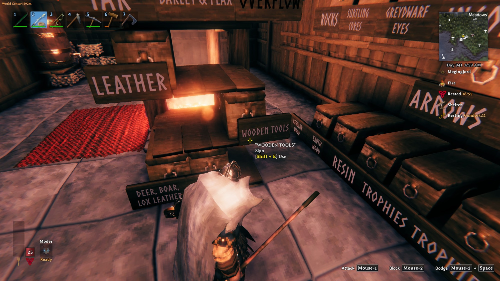
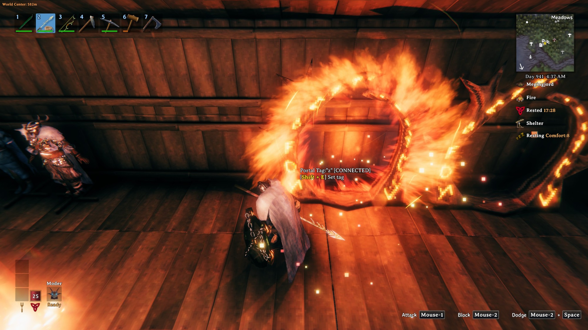
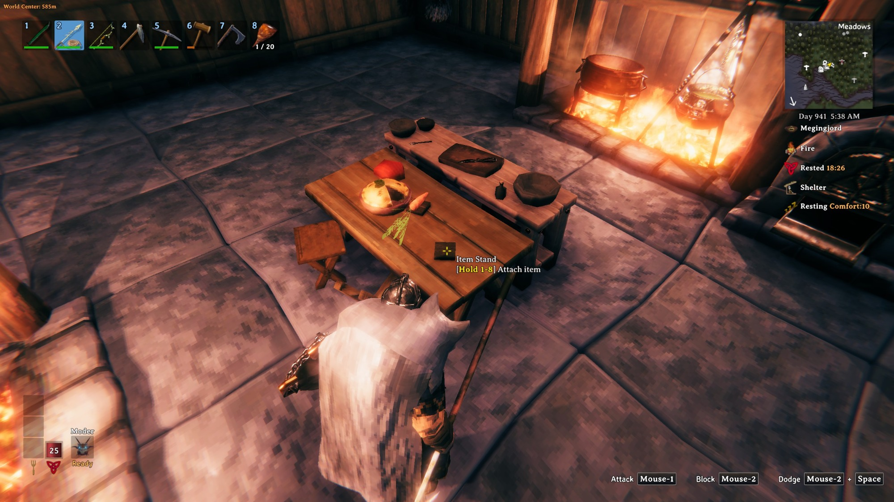
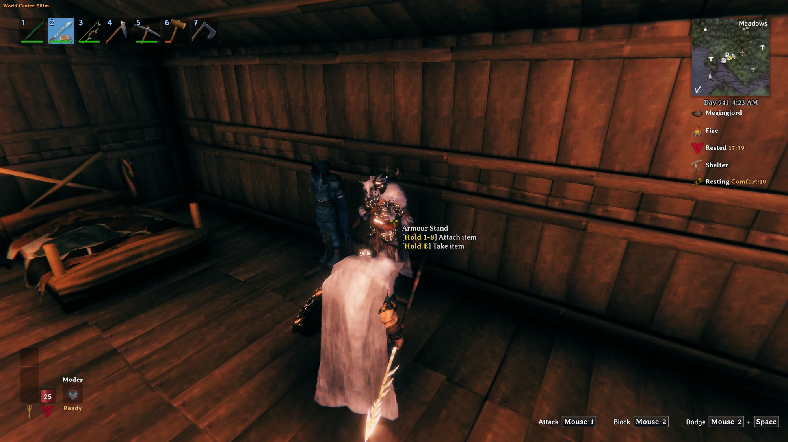

# Steady Signs 1.2.0

A client-side Valheim mod by Swiftfingers that prevents accidental edits and equipment removal.

Steady Signs was previously called Deliberate Interact. Remove the old local mod entry before importing Steady Signs.

| Action | Default control |
| --- | --- |
| Edit a sign | Shift + E |
| Rename a portal tag | Shift + E |
| Take equipment off an armor stand | Hold E |
| Mount an item on an armor stand or item stand | Hold its hotbar key (1–8) |

Aim at a stand and hold the key for the exact hotbar slot you want to mount. A tap while aiming at the stand does nothing. Hotbar keys work as usual away from stands. Hold E removes displayed equipment, and the separate armor-stand pose control keeps its normal binding.

Signs and portals follow the same Alternate Use and Use bindings as tame renaming. The vanilla editing dialogs, access checks, and portal travel are preserved.

Install BepInExPack Valheim, then import the release ZIP as a local mod in r2modman and launch Valheim modded. Only the client needs the mod.

To build against a local game installation, run `scripts/build.ps1 -ValheimDirectory 'C:/path/to/Valheim'`.

[Thunderstore and Nexus publishing setup](https://github.com/jps60/valheim-steady-signs/blob/main/docs/publishing.md)

## Screenshots

**Sign** · Press **Shift + E** to edit the text.

**Portal** · Press **Shift + E** to set the portal tag.

**Item stand** · Hold the item's hotbar key (**1–8**) to attach it.

**Armor stand** · Hold a hotbar key (**1–8**) to attach gear or **E** to take it off.

Inspired by [PreventAccidentalInteraction](https://github.com/PhantomGamers/Valheim-PreventAccidentalInteraction) by PhantomGamers.
